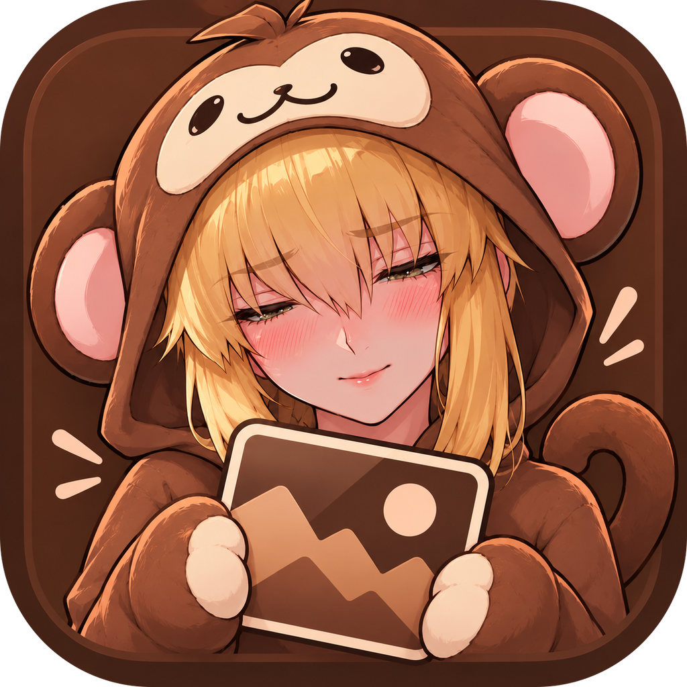

# Chimpanzé Wallpapers — v1.5.8

Wallpapers independentes por monitor para Windows, com transições em GPU estilo motion design, profundidade 3D (parallax) com recorte por IA, personagens de anime que piscam, upscale 4K com IA e um editor de imagem. Tudo roda **local** na sua placa de vídeo.

## Instalar (usuário)

1. Baixe `Chimpanze-Wallpapers-Setup-1.5.8.exe` na página **[Releases](../../releases)**.
2. Rode o instalador e siga os passos. Guia completo, passo a passo e com solução de problemas: **[docs/INSTALACAO.md](docs/INSTALACAO.md)**.

Requisitos: Windows 10 ou 11 (64 bits), placa de vídeo com DirectX 12 (NVIDIA, AMD ou Intel) e cerca de 1,5 GB livres. A edição por IA do Editor usa o aplicativo do ChatGPT para Windows (opcional).

## O que ele faz
- **Por monitor:** pasta, timer e transição próprios; detecta monitores ao iniciar, pelo botão e ao vivo (liga/desliga cabo).
- **75 transições WebGL2** com borrão de movimento automático, curvas de mola/Apple e compilação dos shaders em segundo plano (sem engasgos).
- **Profundidade 3D (parallax)**, ligada por padrão:
  - profundidade de cada imagem estimada por IA (Depth Anything V2) e personagens recortados por um modelo próprio para anime (cabelo solto, armas, grupos);
  - o fundo atrás dos personagens é reconstruído, então nada fica borrado quando a câmera anda;
  - **rostos rígidos:** cada cabeça é detectada e se move como uma peça só, nunca entorta;
  - **análise automática** de cada wallpaper (anime, foto ou paisagem; quantos personagens; cabelo solto; fundo detalhado), que limita o movimento ao que a imagem aguenta sem defeitos;
  - presets Automático, Anime, Paisagem, Pessoas reais e Manual; 7 movimentos de câmera (Órbita, Caminhada, Travelling, Aproximação, Flutuar, Respiração, Balanço);
  - **personagens de anime piscam** de vez em quando (piscada simples, dupla e, raramente, uma piscadela), com pálpebra e cílios descendo juntos, só nos rostos em que o efeito fica natural. Tem um botão próprio ("Piscar dos olhos") e funciona mesmo com a profundidade 3D desligada.
  - **por imagem:** dá para desligar o 3D só num wallpaper e **refazer o recorte** dos personagens (6 tentativas diferentes, com prévia do recorte na Galeria) quando a separação do fundo não ficou boa.
- **Atalhos de teclado globais** (funcionam com o app minimizado ou na bandeja): próximo/anterior (Ctrl+Shift+N / B), fixar (Ctrl+Shift+F), pausar (Ctrl+Shift+Espaço), profundidade 3D (Ctrl+Shift+D), piscar (Ctrl+Shift+P) e mostrar o app (Ctrl+Alt+W). Agem no monitor onde está o mouse; com Alt junto, em todos. Dá para mudar cada um em Ajustes.
- **Upscale 4K/5K/8K** (Real-ESRGAN na GPU) escolhendo imagens da galeria do app, com confirmação e comparação antes/depois.
- **Editor:** abre do computador ou da galeria; ajustes de imagem, recorte, borracha de marca d'água por IA (LaMa), **Pintar** (esconde partes do ChatGPT com um pincel de cor única) e **Colar** (põe o original de volta numa expansão: encaixe automático, só a parte pintada, cores igualadas, perspectiva e ajustes à mão) e edição pelo app do ChatGPT.

Guia de uso de cada página: **[docs/USO.md](docs/USO.md)**.

## Compilar (desenvolvedor)
Veja **[docs/COMPILAR.md](docs/COMPILAR.md)**: dependências, modelos de IA (ficam fora do Git), comandos e estrutura do código.

## Modelos e licenças
Os modelos de IA usados e suas licenças estão em **[docs/MODELOS.md](docs/MODELOS.md)**.

## Arquivos do usuário
- Configuração: `%APPDATA%\Chimpanzé Wallpapers\config.json` · Logs: `%APPDATA%\Chimpanzé Wallpapers\logs\`
- Cache da profundidade (mapas, fundos reconstruídos, pálpebras e análise de cada imagem): `%APPDATA%\Chimpanzé Wallpapers\depth\`
